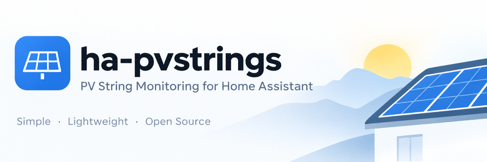
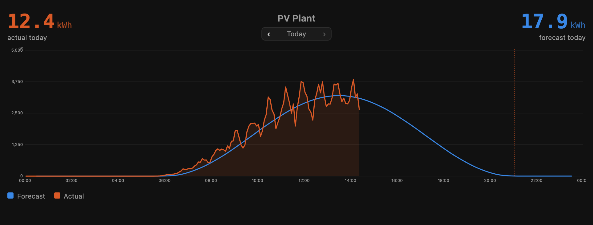
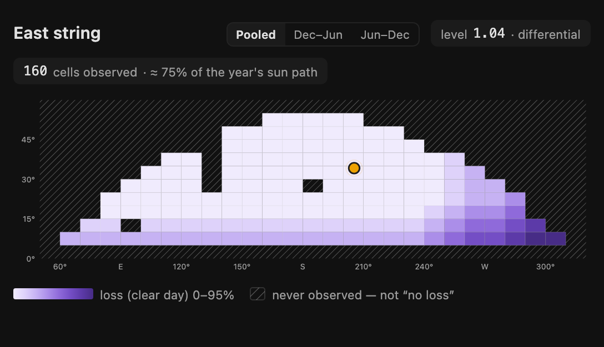
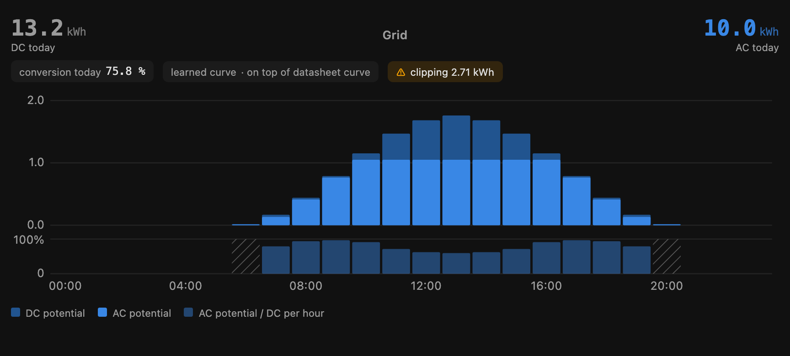
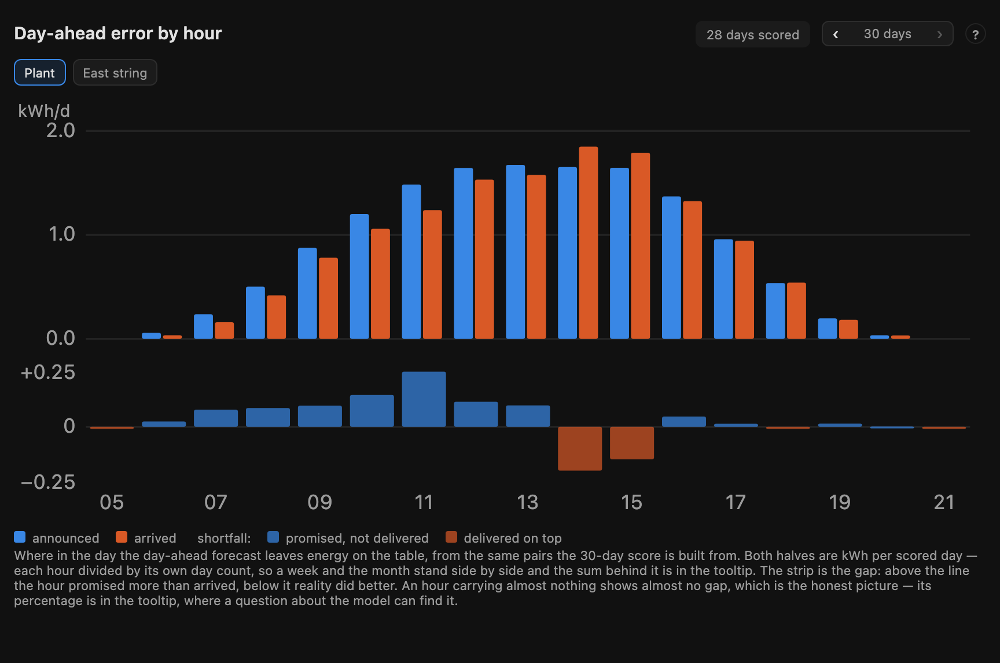

# PV Strings

*Home Assistant 2025.9 or newer · MIT*

PV forecast and analysis for Home Assistant — **per string**, not per plant.
Built for roofs whose strings differ: other orientations, other tilts, a tree
in front of one of them. It needs one measurement channel per string, which an
MPPT-per-string inverter or a set of micro-inverters already gives you.



## Features

- **Forecast per string and per plant** — today, remaining, tomorrow, hourly.
  Physics (`pvlib`) from day one, no training period.
- **Learns your plant** — corrects the weather source, the model and fixed
  shading, separately for every string.
- **Sky map per string** — shows where in the sun's path each string loses
  energy, and how much (trees, buildings, the neighbour's house).
- **Curtailment and inverter limits** — remaining forecast per inverter, DC/AC
  conversion with a learned curve, clipping, battery charge.
- **Honest accuracy figures** — day-ahead error over 7 and 30 days, by hour;
  with an irradiance sensor also whether the weather service or the model was
  wrong.
- **Savings and payback** — from measured energy, with time-of-use tariffs.
- **Local option** — use your own irradiance sensor, or run without internet
  from a Home Assistant weather entity.
- **Dashboard included** — see below.

## Dashboard included

You get a complete dashboard without building it card by card. The cards ship
with the integration and register themselves — nothing to install, no
resources to add, no card editor. Create a new dashboard, open the raw
configuration editor and paste:

```yaml
strategy:
  type: custom:pvstrings
```

That is all. The dashboard builds itself from your strings and grows with them:
overview, one section per string, accuracy, and a nerd view for the learning.
The cards also work on their own in any dashboard —
[card reference](https://github.com/doccodyblue/ha-pvstrings-dash).

| | |
|---|---|
|  |  |



*Screenshots show demo data.*

## Installation

[](https://my.home-assistant.io/redirect/hacs_repository/?owner=doccodyblue&repository=ha-pvstrings&category=integration)

Search for **PV Strings** in HACS, install, restart Home Assistant.

- **Added it before as a custom repository?** Nothing to do.
- **Copied the files by hand?** Install once through HACS so you get updates.
  Configuration and learned data live outside the integration folder
  (`config/pvstrings/`) and are kept.
- **Installed the dashboard separately before 1.26.2?** Home Assistant raises a
  repair asking you to remove that copy; the bundled one replaces it.

Manual install: copy `custom_components/pvstrings/` to
`config/custom_components/` and restart.

## Setup

1. **Add the integration.** Location comes from Home Assistant; the weather
   source is [Open-Meteo](https://open-meteo.com/) — free for home use, no API
   key.
2. **Add a curtailment group** *(optional)* for each inverter that can be
   limited.
3. **Add each string:** power sensor, azimuth, tilt, kWp. Point it at the
   string's own measurement channel, not a sum.
4. **Optional:** grid, battery and local weather sensors in the options. An
   irradiance sensor is the one worth having — mounted horizontally.
5. **Add the dashboard** as shown above.

The forecast works right away. Error figures appear after three complete
scored days; the sky map fills in as the sun crosses new parts of the sky, so
it takes a year to be complete.

## Documentation

| | |
|---|---|
| [Setup](docs/setup.md) | Requirements, all options, irradiance sensor, changing tilt or orientation |
| [Sensors](docs/sensors.md) | Every entity and attribute, using the forecast in automations |
| [How it works](docs/how-it-works.md) | Why per string, the forecast chain, learning, data collection |
| [Shading](docs/shading.md) | The sky map, and what it can and cannot see |
| [Accuracy](docs/accuracy.md) | Error figures, history, weather source vs. model, sensor check |
| [Curtailment](docs/curtailment.md) | DC, AC and battery output, inverter limits |
| [Savings](docs/economics.md) | What is counted, tariffs, time-of-use |
| [Services](docs/services.md) | Services, storage, diagnostics download |
| [Status](docs/status.md) | Test coverage, known limits, what is out of scope |

## Compared with plant-level forecasts

Solcast, Forecast.Solar and the self-learning integrations give one good number
for the whole plant. If that is what you need, use one of them. PV Strings
answers a different question: *which string loses what, and when* — something
a plant total cannot show, because the errors of the strings cancel out in it.

## Support

Questions, ideas and screenshots of your plant:
[Discussions](https://github.com/doccodyblue/ha-pvstrings/discussions).
Bugs: [Issues](https://github.com/doccodyblue/ha-pvstrings/issues) — please
attach the diagnostics download.

## Data sources

Weather data by [Open-Meteo.com](https://open-meteo.com/)
([CC BY 4.0](https://creativecommons.org/licenses/by/4.0/)); commercial
plants need an Open-Meteo API key. Physics by
[pvlib](https://pvlib-python.readthedocs.io/) (BSD-3-Clause). Details in
[How it works](docs/how-it-works.md#data-sources).

## Development

```bash
python3 -m venv .venv
.venv/bin/pip install -r requirements-test.txt
.venv/bin/python -m pytest
```

`custom_components/pvstrings/core/` contains no Home Assistant code and runs
offline.

## Licence

MIT
